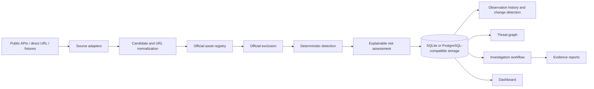

# SENTINEL X

## Evidence-first digital risk protection for public brand identities

SENTINEL X helps security, fraud, and brand-protection teams investigate suspicious
websites, social profiles, and mobile application listings.

> **Observe the signal. Prove the connection. Protect the brand.**

SENTINEL X is built around a simple principle: a similarity score is not an incident.
Analysts need the original observation, exact provenance, official-asset context,
explainable signals, related entities, and a durable investigation record before they
decide what to do.

The platform combines:

- A registered brand and official-asset identity layer.
- Safe live verification of a public URL.
- On-demand live discovery through permitted public APIs.
- Deterministic look-alike and context detection.
- Official-asset exclusion before alert scoring.
- Persistent observation history and change detection.
- Evidence-backed relationship graphs.
- Investigations, analyst decisions, and exportable reports.

## Why it matters

Organizations are copied across places their security team does not control: public
social identities, app marketplaces, support websites, login pages, and look-alike
domains. These signals are fragmented, change quickly, and are difficult to defend
without source context.

SENTINEL X turns a public signal into a reviewable workflow:

```text
Register identity
      ↓
Observe a public asset
      ↓
Preserve source and response evidence
      ↓
Compare against official assets
      ↓
Explain deterministic signals
      ↓
Connect related findings
      ↓
Create an investigation and report
```

## Product capabilities

### Live verification

Submit one public HTTP(S) profile, website, or app-listing URL through the **Live
Verification** workspace. SENTINEL X records:

- Source URL and final URL.
- Redirect-safe observation path.
- UTC observation timestamp.
- HTTP status and content type.
- Page title and description metadata.
- Observed domain and provider.
- Deterministic brand, name, link, and detection signals.
- Whether the result changed since the previous observation.

Live verification is metadata-only. It does not execute page scripts, download app
packages, contact accounts, or produce an automatic maliciousness verdict.

### Live source discovery

The connected workspace supports bounded, on-demand collection from:

| Source | Capability | Access mode |
| --- | --- | --- |
| Bluesky public actor search | Search public actors by protected brand name | Live public API |
| Apple App Store Search API | Search public software listings | Live public API |
| Direct public URL verification | Inspect one public HTTP(S) resource | Live bounded request |
| Synthetic Sentinel X fixtures | Repeatable demo and test scenario | Clearly labeled demo |

Live records are persisted with `metadata.mode = "live"` and source provenance.
Provider failures are isolated and reported as partial results rather than hidden.

### Official-asset registry

Register the identity that should be protected:

- Brand and canonical name.
- Alternative domains.
- Official domains and websites.
- Official social accounts.
- Official mobile applications.
- Approved publisher and support identities.

Official matching takes precedence over normal risk scoring. An exact official match
is excluded before it can become a suspicious alert. A display-name match alone is
never sufficient to mark an asset official.

### Explainable detection

The core engine is deterministic and inspectable. Signals can include:

- Exact, normalized, or look-alike name similarity.
- Unicode confusable characters.
- Character substitutions and transpositions.
- Brand terms embedded in longer names.
- Unapproved domains and links.
- Higher-risk candidate surface types.
- External source provenance.
- Shared domains or stored relationship evidence.

Every score is composed from weighted signals. Missing data is treated as unavailable,
not as evidence of maliciousness. Scores are prioritization assessments, not calibrated
probabilities.

### Observation history and change detection

When a live result is submitted with a protected brand, it is stored as an observation.
The next observation of the same canonical URL is compared with the latest prior state.
The system exposes:

- `changed`.
- `changed_fields`.
- `previous_observed_at`.
- A structured `change_summary`.

This lets an analyst see when a title, redirect target, description, HTTP status, or
other observed field changed.

### Threat graph and investigations

The graph keeps different relationship types separate:

- Official ownership.
- Candidate similarity.
- Shared domain.
- Source provenance.
- Analyst-linked relationships.

Analysts can inspect nodes, view relationship evidence, create an investigation, add
notes, change case status, record feedback, and generate a report snapshot.

## Screens and routes

### Public experience

- `/` — Cinematic Sentinel X landing page.
- `/verify` — Live public URL verification.

### Analyst workspace

- `/overview` — Risk and collection overview.
- `/brands` — Protected brand portfolio.
- `/brands/new` — Register a brand and its first official asset.
- `/discovery` — Unified candidate inventory.
- `/social` — Social identity candidates.
- `/apps` — Mobile application candidates.
- `/investigations` — Case management and analyst decisions.
- `/threat-graph` — Evidence-backed relationship graph.
- `/reports` — Report library and report details.
- `/source-health` — Source provenance and availability.

The frontend also supports `/app/...` compatibility redirects for the workspace routes.

## Architecture



### Backend modules

| Path | Responsibility |
| --- | --- |
| `app/main.py` | FastAPI application, API routes, scans, observations |
| `app/models.py` | SQLAlchemy relational models |
| `app/schemas.py` | Pydantic request and response contracts |
| `app/detection.py` | Normalization, look-alike matching, risk scoring |
| `app/live_check.py` | Safe public URL metadata observation |
| `app/live_sources.py` | Bluesky and Apple live source adapters |
| `app/normalization.py` | HTTP(S) URL and hostname canonicalization |
| `app/seed.py` | Idempotent synthetic demo data |

### Frontend modules

| Path | Responsibility |
| --- | --- |
| `frontend/src/App.tsx` | Application shell, routes, landing page, workspace context |
| `frontend/src/VerifyPage.tsx` | Live URL verification and provenance result view |
| `frontend/src/BrandCreatePage.tsx` | Brand registration workflow |
| `frontend/src/graph.tsx` | Accessible SVG relationship graph |
| `frontend/src/pages.tsx` | Dashboard, discovery, investigations, reports, sources |
| `frontend/src/api.ts` | API resources and offline fallback behavior |
| `frontend/src/styles.css` | Workspace and cinematic landing design system |

## Quick start

### Requirements

- Python 3.12+.
- Node.js 20.19+ or 22.12+.
- npm.

### 1. Clone and enter the project

```bash
git clone https://github.com/shivasync0/SentinelX.git
cd SentinelX
```

### 2. Start the backend

Create a virtual environment and install Python dependencies:

```bash
python -m venv .venv
```

Windows PowerShell:

```powershell
.venv\Scripts\Activate.ps1
pip install -r requirements.txt
uvicorn app.main:app --reload --host 127.0.0.1 --port 8000
```

macOS/Linux:

```bash
source .venv/bin/activate
pip install -r requirements.txt
uvicorn app.main:app --reload --host 127.0.0.1 --port 8000
```

The API and OpenAPI docs are available at:

- API: `http://127.0.0.1:8000`
- Health: `http://127.0.0.1:8000/health`
- OpenAPI UI: `http://127.0.0.1:8000/docs`

### 3. Start the frontend

In a second terminal:

```bash
cd frontend
npm install
npm run dev
```

Open `http://127.0.0.1:5173`.

Vite proxies `/api` to `http://localhost:8000` during development. The workspace
shows a clearly labeled offline demo if the backend is unavailable; it never silently
mixes synthetic fixtures into a partially connected API workspace.

## Configuration

Copy `.env.example` to `.env` when you need custom settings:

```dotenv
SENTINEL_DATABASE_URL=sqlite:///./sentinel_x.db
SENTINEL_CORS_ORIGINS=http://localhost:5173,http://localhost:4173
VITE_API_BASE_URL=/api
```

### Database

SQLite is the default local-development database. A PostgreSQL-compatible SQLAlchemy
URL can be supplied through `SENTINEL_DATABASE_URL` for deployment environments.

The current local bootstrap uses SQLAlchemy metadata creation for a frictionless
demo. Reference migration SQL is provided in:

- `migrations/001_initial.sql` — core relational schema.
- `migrations/002_observations.sql` — live observation history.

### Seed and reset

Seeding is idempotent and also runs during application startup:

```bash
python -m scripts.seed_demo
```

Reset only a local/demo database:

```bash
python -m scripts.reset_demo
```

The synthetic scenario uses fictional Acme Security and Northstar Cloud records. It
is never presented as real-world threat intelligence.

## API highlights

### Live verification

```http
POST /api/live-check
Content-Type: application/json
```

```json
{
  "url": "https://example.com",
  "brand_id": 1,
  "asset_type": "website"
}
```

Supported `asset_type` values:

- `website`
- `social`
- `mobile_app`

### Live source scan

```http
POST /api/brands/{brand_id}/live-scan
```

This performs a bounded on-demand collection through configured public providers,
stores live candidate records, and runs the explainable scan pipeline. The response
sets `deterministic` to `false` and can be `partially_completed` when a provider is
unavailable.

### Observation history

```http
GET /api/observations?brand_id=1&limit=50
GET /api/brands/{brand_id}/observations?limit=50
GET /api/candidates/{candidate_id}/observations?limit=50
```

History results contain provenance, metadata snapshots, signals, and change fields.

### Core resource groups

```text
Brands:         GET/POST/PATCH/DELETE /api/brands
Assets:         GET/POST/PATCH/DELETE /api/official-assets
Candidates:     GET/POST /api/candidates
Feedback:       POST /api/candidates/{id}/feedback
Scans:          GET/POST /api/scans, POST /api/scans/demo
Investigations: GET/POST /api/investigations, PATCH /api/investigations/{id}
Graph:          GET /api/graph?brand_id={id}
Sources:        GET/POST /api/sources, GET /api/sources/health
Reports:        GET/POST /api/reports
```

## Demonstration workflow

The recommended presentation flow is:

1. Open the cinematic landing page.
2. Explain the problem: public identities can imitate a brand across disconnected sources.
3. Open **Live verification**.
4. Submit a public URL such as `https://example.com`.
5. Show the exact source, final URL, timestamp, response metadata, and signals.
6. Run a live brand scan to query Bluesky and Apple App Store public APIs.
7. Open Discovery and compare suspicious candidates with registered official assets.
8. Open the Threat Graph and explain a stored shared-domain relationship.
9. Create an investigation and add analyst context.
10. Generate the evidence report.
11. Open Source Health and show live/demo/unverified provenance states.

The short demo script and slide outline are in `docs/demo-script.md`.

## Test and quality checks

Backend:

```bash
pytest
```

Frontend unit tests and production build:

```bash
cd frontend
npm test
npm run build
```

Frontend end-to-end workflow tests:

```bash
cd frontend
npm run test:e2e
```

The end-to-end suite covers the landing page, offline workflow, connected API
contract, partial API failure state, mobile navigation, and live verification.

## Security and trust boundaries

SENTINEL X is currently a local/demo deployment and does not provide production
authentication, authorization, or multi-tenant isolation.

Implemented safeguards include:

- HTTP(S)-only URL validation.
- Rejection of credentials, malformed addresses, private IPs, loopback, link-local,
  multicast, reserved, and non-global destinations.
- Redirect target revalidation.
- Bounded timeouts and response-size limits.
- Metadata-only HTML parsing.
- No JavaScript execution or application-package downloads.
- No automatic contact, accusation, takedown, or external action.
- Explicit source provenance and live/demo/imported distinctions.
- Official-asset exclusion before risk scoring.
- Persistent analyst feedback and evidence history.

Before public production deployment, add authentication, workspace authorization,
rate limiting, network-level egress controls, connection-time DNS rebinding defenses,
structured audit events, production migrations, encrypted secret management, and
provider-specific terms/rate-limit monitoring.

See `docs/security.md` for the current threat model and `docs/data-sources.md` for
source-specific limits.

## Project status

### Working now

- Full React/Vite analyst workspace.
- FastAPI backend with SQLite persistence.
- Live public URL verification.
- Bluesky and Apple App Store on-demand live adapters.
- Persistent observation history and change detection.
- Official identity registry and exclusion logic.
- Explainable deterministic detection engine.
- Threat graph, investigations, feedback, and reports.
- Cinematic landing page with video crossfade and accessible fallback.
- Automated backend, frontend, and Playwright coverage.

### Deliberately not claimed

- Continuous global monitoring.
- Coverage of every social network or app marketplace.
- Calibrated probability of maliciousness.
- Automatic takedown success.
- Attacker attribution.
- Production-grade multi-tenant security.

## Documentation

- [`docs/architecture.md`](docs/architecture.md) — system design and trust boundaries.
- [`docs/detection-engine.md`](docs/detection-engine.md) — matching logic and limits.
- [`docs/data-sources.md`](docs/data-sources.md) — live, imported, and synthetic data.
- [`docs/security.md`](docs/security.md) — security controls and production gaps.
- [`docs/demo-script.md`](docs/demo-script.md) — 3–5 minute demo and presentation outline.
- [`frontend/README.md`](frontend/README.md) — frontend-specific development notes.

## License

No license has been declared yet. Add a `LICENSE` file before distributing SENTINEL X
outside the repository.
