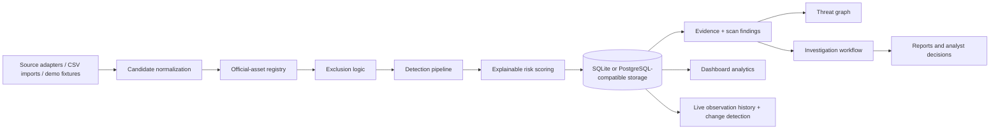

# SENTINEL X architecture

SENTINEL X is a deliberately small, evidence-first digital risk protection MVP. The
backend owns persisted truth; the React client renders that truth and labels offline
fixtures separately when the API is unavailable.

## Runtime boundaries

- `app/main.py` exposes the REST API and scan orchestration.
- `app/normalization.py` canonicalizes HTTP(S) addresses without fetching them.
- `app/detection.py` implements deterministic name, domain, and surface signals.
- `app/seed.py` creates the synthetic Acme Security and Northstar Cloud scenario.
- `frontend/src/api.ts` loads resources independently, so a partial API outage is
  visible instead of silently replaced with fixture data.
- `frontend/src/graph.tsx` renders the stored graph with accessible SVG controls.

## Live observation history

`observations` stores each opted-in `POST /api/live-check` result when a `brand_id`
is supplied. Records retain the source and final URLs, response metadata, normalized
metadata snapshot, extracted links, deterministic signals, live mode, and optional
candidate linkage. A canonical source URL is compared with its latest prior
observation; API results and history endpoints expose `changed`, `changed_fields`,
`previous_observed_at`, and a structured `change_summary`. Bounded history reads are
available at `/api/observations`, `/api/brands/{brand_id}/observations`, and
`/api/candidates/{candidate_id}/observations`. Structured blocked and request-error
results are stored with the same provenance when a brand is supplied.

For local development, SQLite is the default. Set `SENTINEL_DATABASE_URL` to a
PostgreSQL SQLAlchemy URL for a deployment database. The current MVP uses
`Base.metadata.create_all` for a frictionless demo; `migrations/001_initial.sql`
records the intended relational shape for a later Alembic migration.

## Trust model

Official asset matches are evaluated before scoring. Exact canonical host matches and
registered official names are returned as excluded findings, not as high-risk alerts.
Similarity edges and shared-domain edges are kept distinct from ownership edges.
Shared-domain edges include the candidate IDs and stored metadata evidence that caused
the relationship to be emitted.
